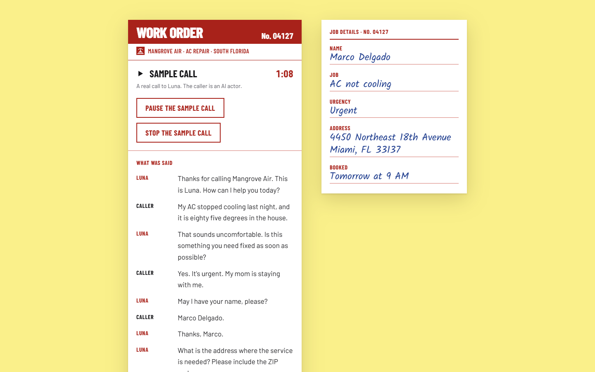
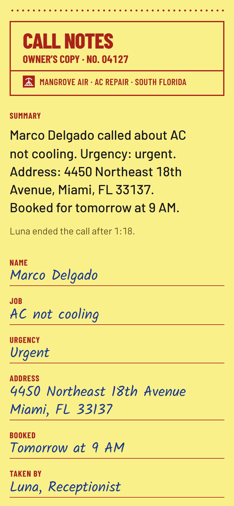

<p align="center"></p>

<p align="center">
  
  
  
  
</p>

**A show-off demo of an AI Receptionist that answers the phone for a made-up South Florida AC repair shop.**

Live site: https://ai-voice-receptionist-tekguyz.vercel.app

## Status

| | |
|---|---|
| Phase | Live |
| Shipped | [#2 Step 1: setup and the Call Story](https://github.com/tekguyz/ai-voice-receptionist/issues/2) · [#3 Step 2: the look](https://github.com/tekguyz/ai-voice-receptionist/issues/3) · [#4 Step 3: live Test Call](https://github.com/tekguyz/ai-voice-receptionist/issues/4) · [#5 Step 4: Call Notes saved](https://github.com/tekguyz/ai-voice-receptionist/issues/5) · [#6 Step 5: Dashboard](https://github.com/tekguyz/ai-voice-receptionist/issues/6) · [#7 Step 6: landing page and design pass](https://github.com/tekguyz/ai-voice-receptionist/issues/7) · [#8 Step 7: the real Sample Call](https://github.com/tekguyz/ai-voice-receptionist/issues/8) · [#15 Tune Luna](https://github.com/tekguyz/ai-voice-receptionist/issues/15) · [#29 Zip code on every address](https://github.com/tekguyz/ai-voice-receptionist/issues/29) · [#9 Step 8: showcase and go live](https://github.com/tekguyz/ai-voice-receptionist/issues/9) · [#10 Step 9: old app retired](https://github.com/tekguyz/ai-voice-receptionist/issues/10) |
| Known issues | [#23 Luna in Spanish: ends in English, mishears short replies](https://github.com/tekguyz/ai-voice-receptionist/issues/23) |
| Next | Nothing planned. The rebuild ([#1](https://github.com/tekguyz/ai-voice-receptionist/issues/1)) is done. |
| Updated | 2026-10-24 |

## Screenshots

<p align="center">
  
  
</p>

## What it does

Built so far:

- A landing page at `/` says what it does, shows a filled-in sample work order and has one "Try the demo" button. Only `/` is in search; demo screens are `noindex`. A link to it shows a preview card drawn by the app (`app/opengraph-image.tsx`). The demo banner has "Leave the demo" and "Built by TEKGUYZ". The Call Notes and the Dashboard end with "Want this answering for your shop? Talk to TEKGUYZ".
- A Visitor presses "Try the demo" (a cookie, no sign-in). Then "Call now" talks to Luna through the browser microphone. Words and tags fill in live. A call stops at 3 minutes. Limits are 1 Test Call per Visitor a day, 2 per IP address a day, 5 per site a day, and 30 a month. At a limit, with a blocked microphone, or when the call cannot connect, the Sample Call is offered.
- Turns a call's events (lines, captured details, a booking, the end) into the live call view and the Call Notes. This is the Call Story, in `lib/call-story.ts`.
- Plays a Sample Call on a plain screen at `/demo`: lines and detail tags appear in time, then the Call Notes show a summary, the details, the booked time and a preview of the confirmation text. The Visitor can pause, resume or stop it. It plays with sound: one real call to Luna made by an AI actor, and the words and tags follow the sound's own clock. One line says so: "A real call to Luna. The caller is an AI actor."
- The Dashboard shows the Owner's side: three totals and recent calls, sample calls mixed with the Visitor's own.
- After a Test Call, the Call Notes are saved for the Visitor and the screen fills in from the saved copy. Each entry is deleted after 7 days. The Vapi webhook (`app/api/vapi/webhook`) refuses any request without Vapi's secret.
- The Receptionist answers in Spanish when the caller speaks Spanish (checked on test calls, 2026-10-05). The screens stay in English. Known gap: she can end a Spanish call in English ([#23](https://github.com/tekguyz/ai-voice-receptionist/issues/23)).
- Luna asks for the zip code with the address, reads it back and says it in the confirmation. Every address on every screen ends with the zip.
- Luna runs on `gpt-4.1-mini`. She confirms the booking, then ends the call by saying "Thanks for calling Mangrove Air, have a great day!" (no end-call tool). Average reply time on the 2026-10-13 calls: 1.6 to 1.9 s. The Test Call screen loads the Vapi SDK when it opens.

## What it never does

- Never dials a phone number. Test Calls run in the browser ([ADR 0001](docs/adr/0001-test-calls-run-in-the-browser.md)).
- No sign-in and no accounts ([ADR 0002](docs/adr/0002-demo-only-no-sign-in.md)).
- Never keeps a Visitor's voice. Only words. This app deletes its copy after 7 days; Vapi keeps its own call logs under its own retention ([ADR 0004](docs/adr/0004-no-audio-kept.md)).
- Never sends a text or email. The confirmation text is a preview.
- Never uses a real business. The Sample Business is made up.
- The browser never holds a Vapi key. The server makes each call with a 60-second token that only works for Luna.

## Stack

Next.js (App Router), TypeScript, Tailwind CSS, Vitest, on Vercel. Voice is the Vapi web SDK. Upstash Redis holds call limits and Call Notes ([ADR 0003](docs/adr/0003-redis-not-supabase.md)).

## Run it locally

Prerequisites: Node 24, a Vapi account and an Upstash Redis database.

```bash
npm install
cp .env.example .env.local
```

Fill in `.env.local`. Vapi can reach only a public address, so Call Notes are saved only on a deployed Preview or Production, not on localhost. Set `VAPI_WEBHOOK_SECRET` in `.env.local` and in Vercel. Then:

```bash
npm run vapi:sync
npm run dev
```

Open `http://localhost:3000` and press "Try the demo".

Luna's settings live in `vapi/luna.ts`. Never edit Luna in the Vapi dashboard; the next sync overwrites it.

To test what would be sent without sending: `npm run vapi:sync -- --dry-run`.

The Sample Business and Receptionist names live in one file, `lib/sample-business.ts`.

## Make the Sample Call

The Sample Call is one real call to Luna, made by an AI actor that plays the caller ("Caller actor · Mangrove Air", `vapi/actor.ts`), recorded on purpose ([ADR 0004](docs/adr/0004-no-audio-kept.md)). Every detail is made up. Recording is off for every Visitor. It turns on only on the laptop's `npm run dev`, never on Vercel.

1. `npm run vapi:sync` sends Luna and the actor to Vapi. Put the `VAPI_ACTOR_ID` it prints in `.env.local`.
2. Add the deployed site to `.env.local`. Vapi cannot reach the laptop, so Luna's tool calls go to its webhook:

   ```
   SAMPLE_CALL_WEBHOOK_ORIGIN=https://ai-voice-receptionist-tekguyz.vercel.app
   ```

3. Run `npm run dev` and open `/dev/actor-call` (dev only; 404 everywhere else). Press "Start the call". The actor and Luna talk in that tab: each call's speaker feeds the other's microphone. `?lang=es` makes the actor speak Spanish; `?seconds=50` stops both calls early.
4. Score the call (the page prints Luna's call ID):

   ```bash
   npm run luna:report -- <callId>
   ```

5. When Luna passes, add `SAMPLE_CALL_RECORDING=on` to `.env.local` and make one more call. The terminal says "This call is recorded for the Sample Call." Then delete that line. Recording is off again.
6. Pull the call. It writes `public/sample-call.mp3` and `lib/sample-call.json`, and places lines that Vapi logged with no length at their real speech start:

   ```bash
   npm run sample-call:pull -- <callId>
   ```

7. Check it: `npx vitest run lib/__tests__/sample-call.test.ts`, then play it on `/demo`. If the words come early or late, pull again with `--offset-ms <ms>` (the 2026-10-13 and 2026-10-14 calls used `-230`).
8. Commit both files. Then delete the call and its recording from Vapi:

   ```bash
   npm run sample-call:pull -- --delete <callId>
   ```

## Tests

```bash
npm run test:unit
```

Never `npm test`: it prints an error and stops on purpose. There is no database, so there is no integration suite.

CI (`.github/workflows/ci.yml`) runs typecheck, `test:unit` and build on every pull request and on every push to `main`.

## Docs

- Spec: [#1](https://github.com/tekguyz/ai-voice-receptionist/issues/1)
- Glossary: [`CONTEXT.md`](CONTEXT.md)
- Product: [`PRODUCT.md`](PRODUCT.md)
- Decisions: [`docs/adr/`](docs/adr/)
- Design references: [`refs/`](refs/)
- Design rules: [`DESIGN.md`](DESIGN.md)

---

<p align="center"><sub>Built by <a href="https://tekguyz.com">TEKGUYZ</a></sub></p>
